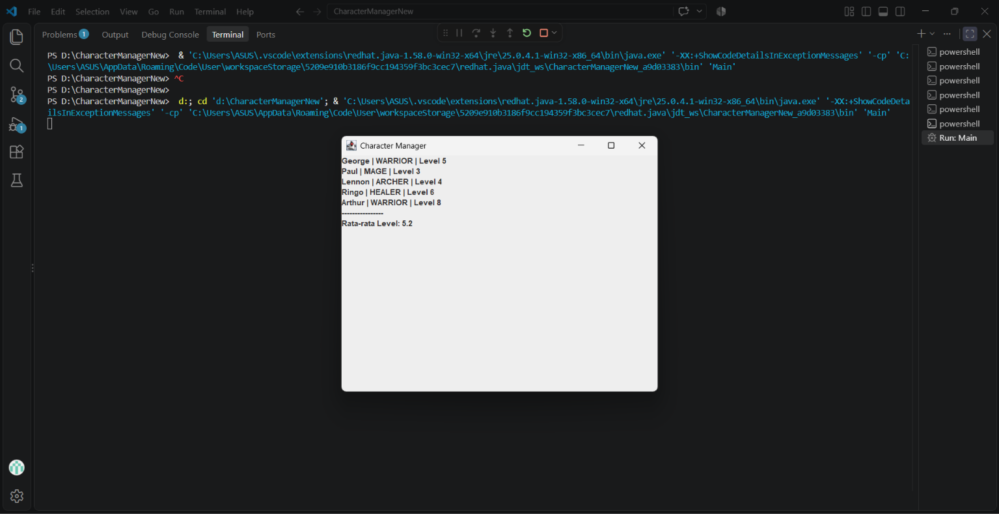
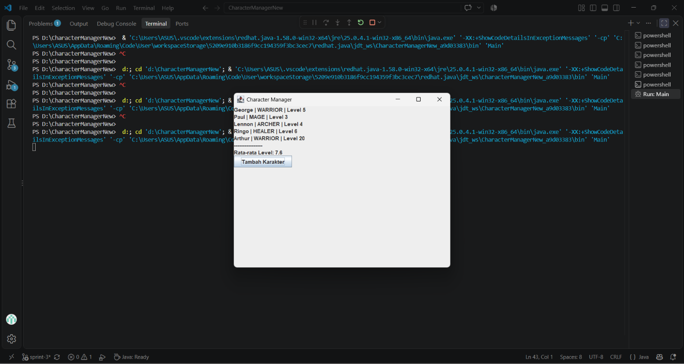
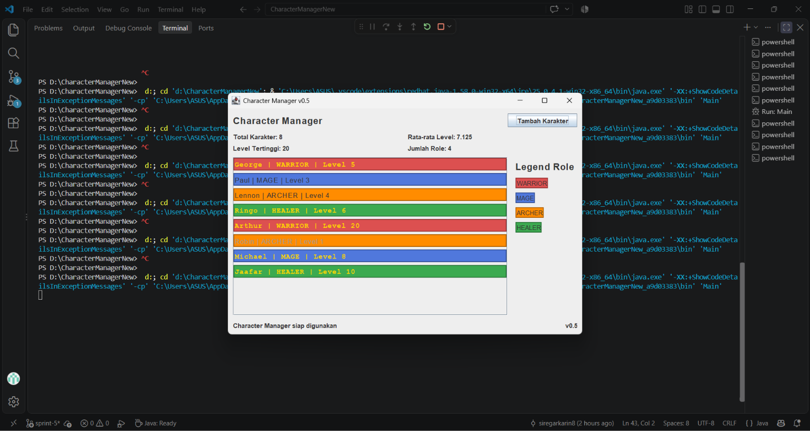
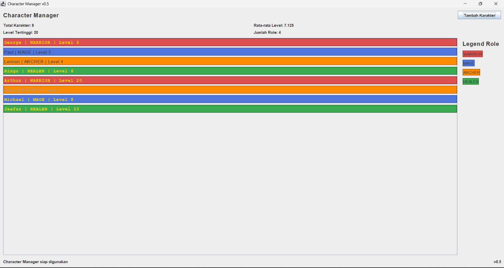
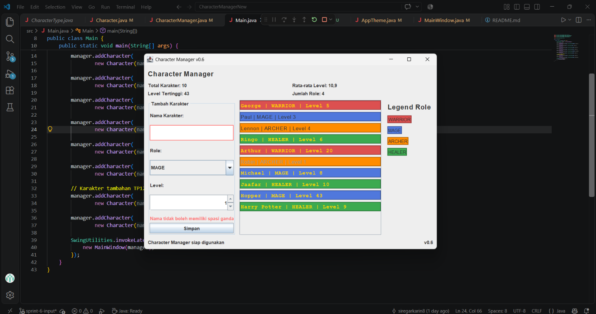
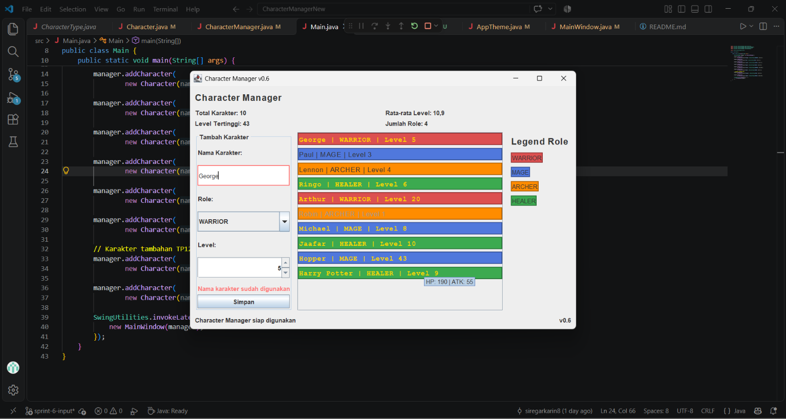
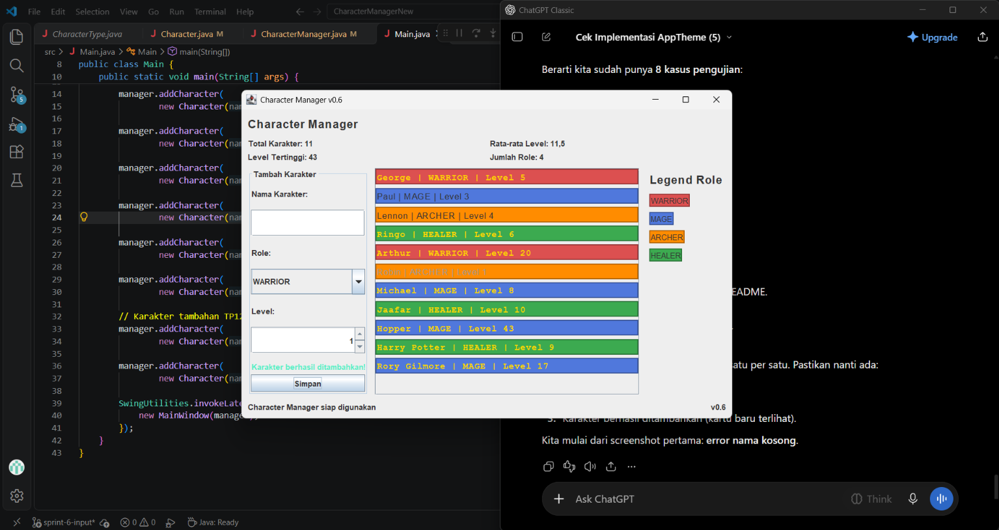

# Character Manager — TP3 (Java Visual SIH-6406)

### Deskripsi
Character Manager adalah aplikasi Java sederhana yang dibuat untuk menerapkan konsep Object-Oriented Programming (OOP). Program ini menggunakan enum CharacterType, constructor overloading, encapsulation melalui getter dan setter, atribut mana, serta method isAlive() untuk mengelola data karakter.

### Screenshot Output


### Struktur Folder

```text
Project_CharacterManager
├── README.md
├── output-tp3.png
└── src
    ├── Main.java
    └── com
        └── unpri
            └── charactermanager
                └── model
                    ├── Character.java
                    └── CharacterType.java
```

### Fitur yang Diimplementasikan
Enum CharacterType
Constructor Overloading
Encapsulation (getter dan setter)
Validasi level karakter
Sistem mana
Method isAlive()
Simulasi level up karakter
Override method toString()

Google Docs (Bagian D): [ISI_LINK_GOOGLE_DOCS](https://1drv.ms/w/c/3F04BCD0705D5ACD/IQADKbmABdrOT5O3FwvbyGRZAVrmOf9n6Q5jkHeE9KdBFQk?e=ZdVWFV)

------------------------------------------------------------------------------------------------------------------------------------------------------------------------

# TP5 - Character Manager Enhancement

### Fitur yang Ditambahkan

Implementasi method equals()
Penolakan karakter dengan nama duplikat
Implementasi findByName()
Implementasi getAverageLevel()
Implementasi findByType()
Implementasi countByType()

### Screenshot Output TP5


Screenshot menunjukkan:

Penolakan karakter duplikat.
Hasil pencarian karakter berdasarkan nama.
Eksperimen reference menggunakan getAllCharacters().
Perhitungan rata-rata level karakter.
Pencarian karakter berdasarkan tipe.
Penghitungan jumlah karakter berdasarkan tipe.

### Fitur Tambahan (Bagian C)
countByType(CharacterType type)
Method ini digunakan untuk menghitung jumlah karakter berdasarkan tipe tertentu.

Contoh:
manager.countByType(CharacterType.WARRIOR);

Google Docs (Bagian D): [TP5](https://ap.wps.com/cms/docs/d/cbCaivqT0qtFzBAz?platform=pc&refer=copylink)
------------------------------------------------------------------------------------------------------------------------------------------------------------------------

--------------------------------------------------

# TP8 - GUI Character Manager

### Deskripsi

Pada TP8 aplikasi Character Manager dikembangkan dari aplikasi console menjadi aplikasi GUI menggunakan Java Swing. Data karakter ditampilkan pada jendela MainWindow secara dinamis menggunakan perulangan, serta ditambahkan statistik rata-rata level karakter.

Screenshot Sebelum Perubahan



Screenshot Sesudah Perubahan



### Penjelasan Aliran Data (MVC)

Data karakter dibuat di Main.java lalu disimpan ke dalam CharacterManager sebagai tempat pengelolaan data. MainWindow mengambil data dari CharacterManager menggunakan method getAllCharacters() dan menampilkannya ke GUI menggunakan JLabel. Dalam konsep MVC, Character dan CharacterManager berperan sebagai Model, sedangkan MainWindow berperan sebagai View yang menampilkan data kepada pengguna.

Karakter Baru

- Lennon (ARCHER, Level 4)
- Ringo (HEALER, Level 6)
- Arthur (WARRIOR, Level 20)

### Alasan Pemilihan

Karakter tambahan digunakan untuk menunjukkan variasi tipe karakter dan memberikan data yang cukup untuk menghitung statistik rata-rata level secara dinamis.

### Struktur Folder TP8

```text
CharacterManagerNew
├── README.md
├── tp3.png
├── screenshots
│   ├── tp5.png
│   ├── tp8-before.png
│   └── tp8-after.png
└── src
    ├── Main.java
    └── com
        └── unpri
            └── charactermanager
                ├── model
                │   ├── Character.java
                │   ├── CharacterManager.java
                │   └── CharacterType.java
                └── view
                    └── MainWindow.java
```


Google Docs (Bagian D): [TP8](https://1drv.ms/w/c/3F04BCD0705D5ACD/IQAbmla5f8JuRYS3-MF2JoUcATAZl6GZCXxTnMkru664wGc?e=HMhOug)

------------------------------------------------------------------------------------------------------------------------------------------------------------------------

# TP10 - Theming, Properti Komponen & Analisis MVC

### Deskripsi

Pada TP10 aplikasi Character Manager dikembangkan dengan penerapan tema menggunakan AppTheme.java. Pengaturan warna, font, dan border dipisahkan dari MainWindow agar tampilan aplikasi lebih terstruktur. Setiap kartu karakter memiliki warna sesuai role dan karakter dengan level minimal 5 mendapatkan teks berwarna emas serta tebal.

Screenshot Output TP10
tp10.png)

Screenshot Output TP10
tp10.png)

### Fitur yang Diimplementasikan

-Implementasi AppTheme.java pada package view.
-Minimal tiga warna.
-Minimal tiga font.
-Minimal satu border.
-Implementasi method colorFor().
-Warna kartu karakter berdasarkan role.
-Highlight level ≥ 5 dengan teks emas dan tebal.
-Penggunaan konstanta batas level.
-Penggunaan setOpaque(true).
-Penggunaan pack() pada jendela.

### Properti Tambahan

1. Tooltip Karakter

Tooltip digunakan untuk menampilkan informasi karakter ketika kursor diarahkan ke kartu sehingga pengguna dapat melihat detail karakter dengan mudah.

2. Border Berdasarkan Role

Border dibedakan berdasarkan role karakter agar setiap tipe karakter lebih mudah dikenali melalui tampilannya.

### Analisis Pemisahan AppTheme dan Character

Warna disimpan di AppTheme karena pengaturan warna merupakan bagian dari tampilan aplikasi (View), bukan data karakter (Model). Character bertugas menyimpan dan mengelola informasi karakter, sedangkan AppTheme mengatur tampilan visual berdasarkan role. Pemisahan ini membuat kode lebih terstruktur, mudah diperbarui, dan menjaga prinsip pemisahan tanggung jawab dalam konsep MVC.

Dengan demikian, perubahan tema tidak perlu mengubah class Character sehingga Model tetap dapat digunakan tanpa bergantung pada komponen tampilan Java Swing.

```text
CharacterManagerNew
├── README.md
├── tp3.png
├── screenshots
│   ├── tp5.png
│   ├── outputtp8_sebelum.png
│   ├── outputtp8_sesudah.png
│   ├── Sebelum(v0.3)tp10.png
│   └── Sesudah(v0.4)tp10.png
└── src
    ├── Main.java
    └── com
        └── unpri
            └── charactermanager
                ├── model
                │   ├── Character.java
                │   ├── CharacterManager.java
                │   └── CharacterType.java
                └── view
                    ├── AppTheme.java
                    └── MainWindow.java
```

Google Docs (Bagian D): [TP10](https://1drv.ms/w/c/3F04BCD0705D5ACD/IQDrsZsyw0DNRLjsvZVr5hz-AVMfmnXl0pa3f7PjcGQz4Yk?e=LgkQJX)

------------------------------------------------------------------------------------------------------------------------------------------------------------------------

# Character Manager — TP12

## Sprint #5: Layout, UI Responsif & Analisis MVC

### Deskripsi Proyek

Character Manager merupakan aplikasi sederhana berbasis Java Swing untuk mengelola data karakter RPG.

Pada TP12 Sprint #5, aplikasi dikembangkan dengan menerapkan Layout Manager untuk menghasilkan tampilan antarmuka yang lebih terstruktur dan responsif terhadap perubahan ukuran jendela.

### Fitur Aplikasi

-Menampilkan daftar karakter.
-Menampilkan nama, role, dan level karakter.
-Menampilkan statistik karakter.
-Menampilkan legenda berdasarkan jenis role.
-Menambahkan karakter baru.
-Menampilkan informasi HP dan ATK melalui tooltip.
-Menggunakan scrollbar untuk daftar karakter.
-Menyesuaikan tampilan ketika ukuran jendela berubah.

### Struktur Folder

```text
CharacterManagerNew
├── README.md
├── tp3.png
├── screenshots
│   ├── tp5.png
│   ├── outputtp8_sebelum.png
│   ├── outputtp8_sesudah.png
│   ├── Sebelum(v0.3)tp10.png
│   ├── Sesudah(v0.4)tp10.png
│   ├── 01-ukuran-awal.png
│   ├── 02-jendela-dilebarkan.png
│   └── 03-jendela-dikecilkan.png
└── src
    ├── Main.java
    └── com
        └── unpri
            └── charactermanager
                ├── model
                │   ├── Character.java
                │   ├── CharacterManager.java
                │   └── CharacterType.java
                └── view
                    ├── AppTheme.java
                    └── MainWindow.java
```

### Implementasi Layout Manager

Pada Sprint #5, aplikasi menggunakan beberapa Layout Manager:

1. BorderLayout
Digunakan pada panel utama untuk membagi tampilan menjadi empat bagian, yaitu NORTH, CENTER, EAST, dan SOUTH.

2. GridLayout
Digunakan pada panel statistik dengan susunan 2 baris dan 2 kolom. GridLayout dipilih karena setiap komponen memiliki pembagian ruang yang sama.
3. BoxLayout
Digunakan pada panel Legend Role dengan arah vertikal agar daftar role tersusun dari atas ke bawah.
4. JScrollPane
Digunakan untuk membungkus daftar karakter sehingga pengguna dapat menggulir daftar ketika ruang tampilan tidak mencukupi.

### Wireframe Tampilan

+------------------------------------------------------+
|                    HEADER (NORTH)                    |
|  Character Manager                  Tambah Karakter  |
|  Total Karakter     Rata-rata Level                  |
|  Level Tertinggi    Jumlah Role                       |
+--------------------------------------+---------------+
|                                      |               |
|           CHARACTER LIST             |  LEGEND ROLE  |
|                                      |               |
|  [Character Card 1]                  |  WARRIOR      |
|  [Character Card 2]                  |  MAGE         |
|  [Character Card 3]                  |  ARCHER       |
|  [Character Card 4]                  |  HEALER       |
|  [Character Card ...]                |               |
|                                      |               |
|             JScrollPane              |               |
+--------------------------------------+---------------+
|                    STATUS BAR                        |
|  Character Manager siap digunakan              v0.5 |
+------------------------------------------------------+

Screenshot Implementasi
1. 

2. 

3. tp10.png)

### Tabel Observasi Perubahan Ukuran Jendela

| Kondisi | Prediksi | Hasil Pengamatan |
|---|---|---|
| Ukuran awal | Komponen ditampilkan sesuai ukuran awal jendela. | Semua bagian aplikasi terlihat dengan baik. |
| Jendela dilebarkan | Komponen menyesuaikan ruang yang tersedia. | Daftar karakter melebar dan legend tetap berada di sebelah kanan. |
| Jendela dikecilkan | Daftar karakter membutuhkan scrollbar ketika ruang tidak mencukupi. | Scrollbar vertikal muncul sehingga daftar karakter tetap dapat diakses. |

### Penjelasan Nested Panels

Nested panels merupakan penggunaan panel di dalam panel lain untuk membagi dan mengatur komponen antarmuka. Pada aplikasi Character Manager, panel utama menggunakan BorderLayout sebagai wadah untuk beberapa panel lainnya. Di dalamnya terdapat panel header, panel statistik, panel daftar karakter, dan panel legend. Setiap panel dapat menggunakan Layout Manager yang berbeda sesuai kebutuhan. Dengan nested panels, tampilan aplikasi menjadi lebih terorganisasi dan mudah dikembangkan.

### Alasan Pemilihan Layout

GridLayout dipilih untuk bagian statistik karena komponen perlu ditampilkan dalam susunan baris dan kolom dengan ukuran yang sama. Sementara itu, BoxLayout dipilih untuk bagian Legend Role karena daftar role lebih sesuai disusun secara vertikal. Untuk daftar karakter, GridLayout digunakan agar setiap kartu memiliki susunan yang konsisten. Layout tersebut kemudian ditempatkan dalam JScrollPane agar daftar tetap dapat diakses ketika ukuran jendela diperkecil.

### Pemisahan Model dan View (MVC)

Aplikasi ini menerapkan konsep pemisahan Model dan View. Package model bertanggung jawab mengelola data dan logika karakter, sedangkan package view bertanggung jawab mengatur tampilan antarmuka menggunakan Java Swing. Pemisahan ini membuat kode lebih terstruktur dan memudahkan perubahan tampilan tanpa harus mengubah logika pengolahan data.

Google Docs (Bagian D): [TP12](https://1drv.ms/w/c/3F04BCD0705D5ACD/IQAgL0mMxQgIT7jPzp41MFPXATgCJMVpTxq3eVUk-UaNEnQ?e=CDFl6E)

------------------------------------------------------------------------------------------------------------------------------------------------------------------------

---

# Character Manager — TP14

## Sprint #6: Form Input, Validasi & Analisis MVC

### Deskripsi

Pada Sprint-6, aplikasi Character Manager dikembangkan dengan menambahkan form input karakter menggunakan Java Swing. Form ini dilengkapi validasi nama, pemilihan role, dan pengaturan level karakter.

Validasi dilakukan pada View dan Model untuk memastikan data yang dimasukkan sesuai aturan sebelum disimpan ke dalam CharacterManager.

### Fitur yang Diimplementasikan

- Form input menggunakan JTextField, JComboBox, dan JSpinner.
- Validasi nama kosong.
- Validasi panjang nama 3–20 karakter.
- Validasi format nama menggunakan huruf dan spasi.
- Penolakan nama duplikat.
- Penolakan penggunaan spasi ganda.
- Validasi level karakter 1–99.
- Validasi khusus MAGE dengan batas maksimal level 60.
- Pesan kesalahan ditampilkan langsung pada form.
- Border merah ketika terjadi kesalahan.
- Karakter baru ditampilkan melalui refreshList().
- Statistik diperbarui setelah karakter berhasil ditambahkan.

### Screenshot Implementasi

1. Validasi nama kosong



2. Validasi nama duplikat



3. Penambahan karakter berhasil



### Tabel Pengujian

| No. | Input Pengujian | Hasil yang Diharapkan | Hasil Aktual | Status |
|---|---|---|---|---|
| 1 | Nama kosong | Nama tidak boleh kosong | Pesan kesalahan muncul | Berhasil |
| 2 | Nama George | Nama duplikat ditolak | Pesan nama sudah digunakan muncul | Berhasil |
| 3 | MAGE level 61 | Level ditolak | Pesan batas level MAGE muncul | Berhasil |
| 4 | Nama valid, MAGE level 50 | Karakter ditambahkan | Karakter berhasil ditambahkan | Berhasil |
| 5 | Nama Al | Nama ditolak | Pesan panjang nama muncul | Berhasil |
| 6 | Nama lebih dari 20 karakter | Nama ditolak | Pesan panjang nama muncul | Berhasil |
| 7 | Nama Merlin123 | Format ditolak | Pesan format nama muncul | Berhasil |
| 8 | Nama dengan spasi ganda | Nama ditolak | Pesan spasi ganda muncul | Berhasil |

### Aturan Validasi Tambahan

1. Nama karakter dibatasi maksimal 20 karakter dan minimal 3 karakter. Aturan ini ditempatkan pada View karena berkaitan dengan pemeriksaan input pengguna.
2. Nama karakter tidak boleh menggunakan spasi ganda. Aturan ini ditempatkan pada View karena merupakan aturan format input.

### Pemisahan Validasi View dan Model

Validasi pada View digunakan untuk memberikan informasi kesalahan secara langsung kepada pengguna sebelum data diproses. Sementara itu, validasi pada Model memastikan data karakter tetap memenuhi aturan meskipun dibuat melalui jalur lain di luar form.

Aturan khusus MAGE dengan level maksimal 60 ditempatkan pada Model agar aturan tersebut tetap berlaku untuk semua proses pembuatan dan perubahan karakter.

### Catatan Implementasi

Pada Sprint #6, ActionListener masih digunakan secara sederhana untuk menangani tombol Simpan. Selain itu, CharacterFormPanel masih memanggil CharacterManager secara langsung melalui manager.addCharacter(). Kedua hal tersebut merupakan kompromi sementara agar fitur input dan validasi dapat berjalan. Pada pengembangan berikutnya, pemisahan tanggung jawab dapat ditingkatkan agar struktur MVC menjadi lebih baik.

### Google Docs (Bagian D)

[[TP14](https://1drv.ms/w/c/3F04BCD0705D5ACD/IQCOp7zoPx5MQ5VNk-3EW0C3AePcMfSpwcIRXhvFaQ0qQMg?e=CvhCAS)]