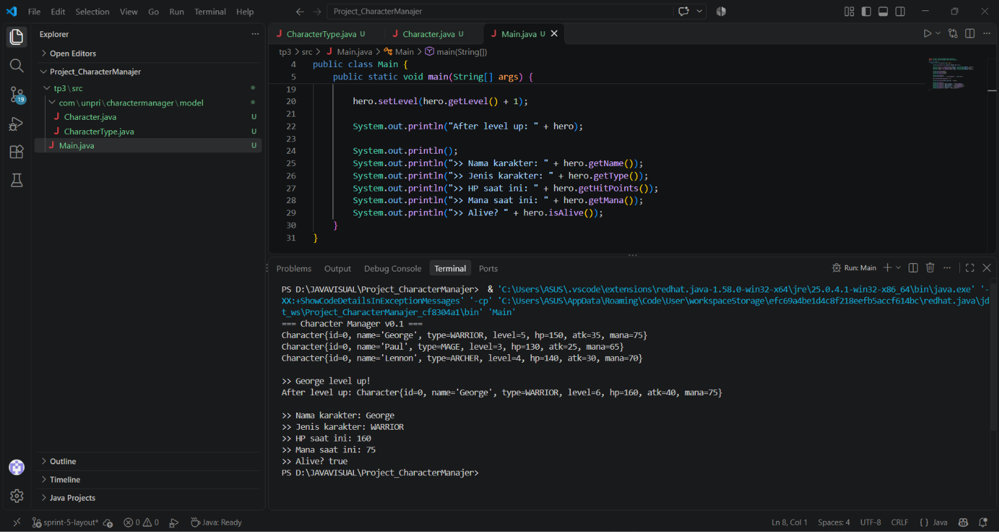
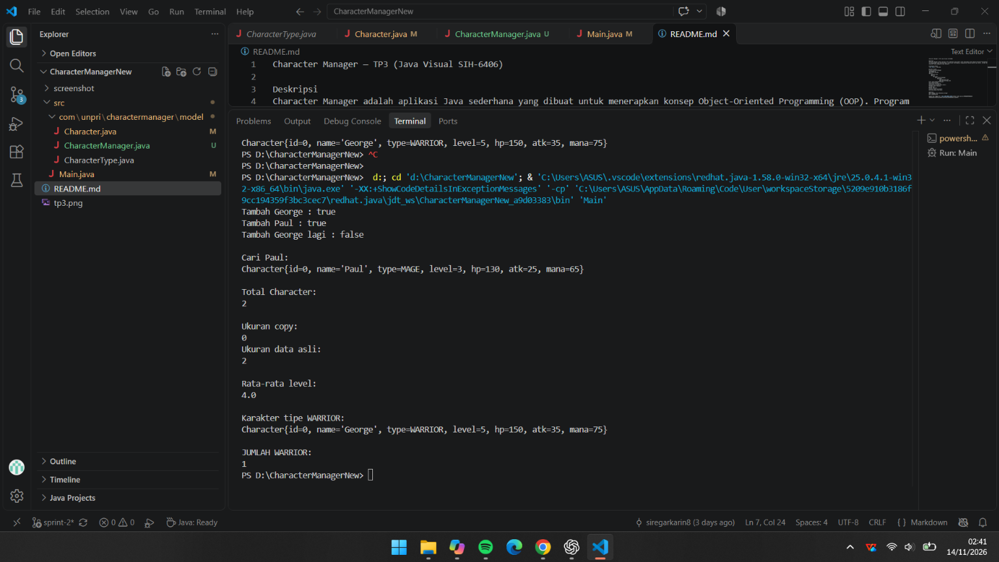

Character Manager — TP3 (Java Visual SIH-6406)

Deskripsi
Character Manager adalah aplikasi Java sederhana yang dibuat untuk menerapkan konsep Object-Oriented Programming (OOP). Program ini menggunakan enum CharacterType, constructor overloading, encapsulation melalui getter dan setter, atribut mana, serta method isAlive() untuk mengelola data karakter.

Screenshot Output


Struktur Folder

```text
Project_CharacterManager
├── README.md
├── output-tp3.png
└── src
    ├── Main.java
    └── com
        └── unpri
            └── charactermanager
                └── model
                    ├── Character.java
                    └── CharacterType.java
```

Fitur yang Diimplementasikan
Enum CharacterType
Constructor Overloading
Encapsulation (getter dan setter)
Validasi level karakter
Sistem mana
Method isAlive()
Simulasi level up karakter
Override method toString()

Google Docs (Bagian D): [ISI_LINK_GOOGLE_DOCS](https://1drv.ms/w/c/3F04BCD0705D5ACD/IQADKbmABdrOT5O3FwvbyGRZAVrmOf9n6Q5jkHeE9KdBFQk?e=ZdVWFV)

------------------------------------------------------------------------------------------------------------------------------------------------------------------------

TP5 - Character Manager Enhancement
Fitur yang Ditambahkan

Implementasi method equals()
Penolakan karakter dengan nama duplikat
Implementasi findByName()
Implementasi getAverageLevel()
Implementasi findByType()
Implementasi countByType()

Screenshot Output TP5


Screenshot menunjukkan:

Penolakan karakter duplikat.
Hasil pencarian karakter berdasarkan nama.
Eksperimen reference menggunakan getAllCharacters().
Perhitungan rata-rata level karakter.
Pencarian karakter berdasarkan tipe.
Penghitungan jumlah karakter berdasarkan tipe.

Fitur Tambahan (Bagian C)
countByType(CharacterType type)
Method ini digunakan untuk menghitung jumlah karakter berdasarkan tipe tertentu.

Contoh:
manager.countByType(CharacterType.WARRIOR);

Google Docs (Bagian D): [TP5](https://ap.wps.com/cms/docs/d/cbCaivqT0qtFzBAz?platform=pc&refer=copylink)
------------------------------------------------------------------------------------------------------------------------------------------------------------------------

--------------------------------------------------

TP8 - GUI Character Manager

Deskripsi

Pada TP8 aplikasi Character Manager dikembangkan dari aplikasi console menjadi aplikasi GUI menggunakan Java Swing. Data karakter ditampilkan pada jendela MainWindow secara dinamis menggunakan perulangan, serta ditambahkan statistik rata-rata level karakter.

Screenshot Sebelum Perubahan


Screenshot Sesudah Perubahan


Penjelasan Aliran Data (MVC)

Data karakter dibuat di Main.java lalu disimpan ke dalam CharacterManager sebagai tempat pengelolaan data. MainWindow mengambil data dari CharacterManager menggunakan method getAllCharacters() dan menampilkannya ke GUI menggunakan JLabel. Dalam konsep MVC, Character dan CharacterManager berperan sebagai Model, sedangkan MainWindow berperan sebagai View yang menampilkan data kepada pengguna.

Karakter Baru

- Lennon (ARCHER, Level 4)
- Ringo (HEALER, Level 6)
- Arthur (WARRIOR, Level 20)

Alasan Pemilihan

Karakter tambahan digunakan untuk menunjukkan variasi tipe karakter dan memberikan data yang cukup untuk menghitung statistik rata-rata level secara dinamis.

Struktur Folder TP8

```text
CharacterManagerNew
├── README.md
├── tp3.png
├── screenshots
│   ├── tp5.png
│   ├── tp8-before.png
│   └── tp8-after.png
└── src
    ├── Main.java
    └── com
        └── unpri
            └── charactermanager
                ├── model
                │   ├── Character.java
                │   ├── CharacterManager.java
                │   └── CharacterType.java
                └── view
                    └── MainWindow.java
```


Google Docs (Bagian D): [TP8](https://1drv.ms/w/c/3F04BCD0705D5ACD/IQAbmla5f8JuRYS3-MF2JoUcATAZl6GZCXxTnMkru664wGc?e=HMhOug)

